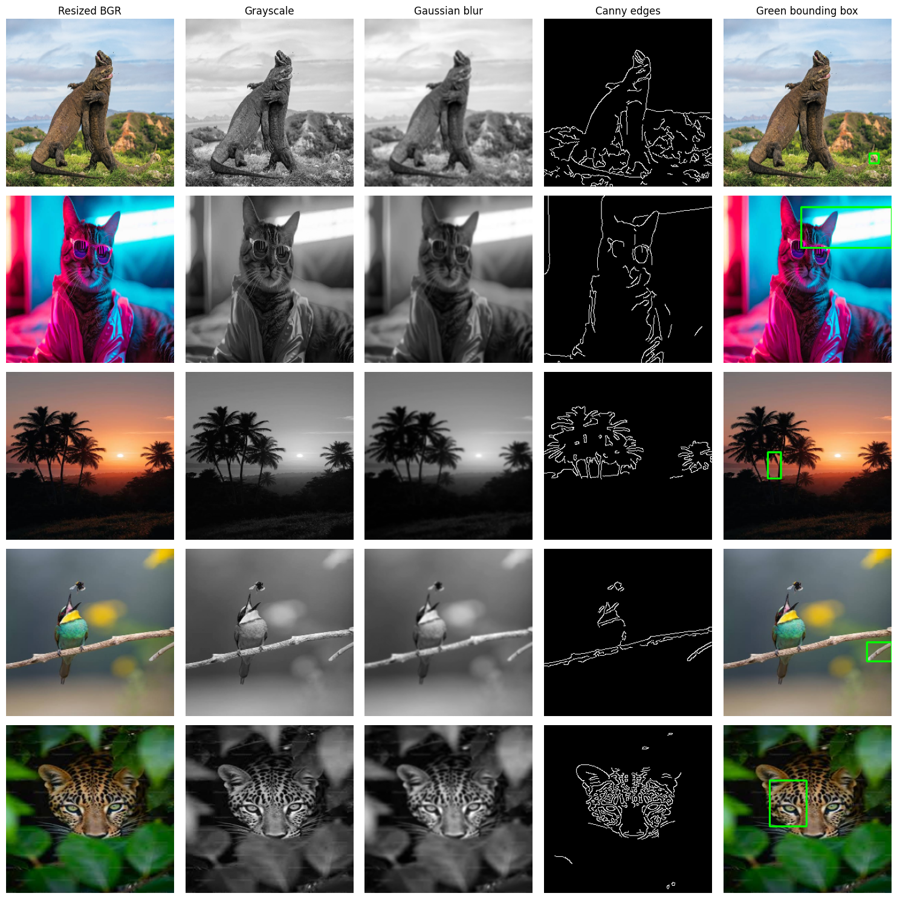
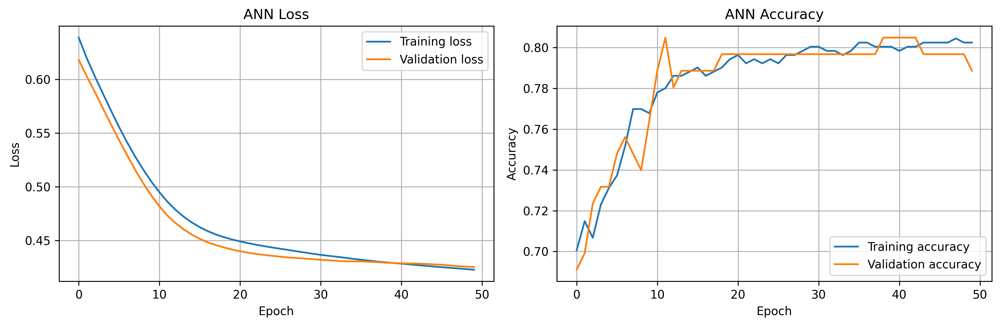
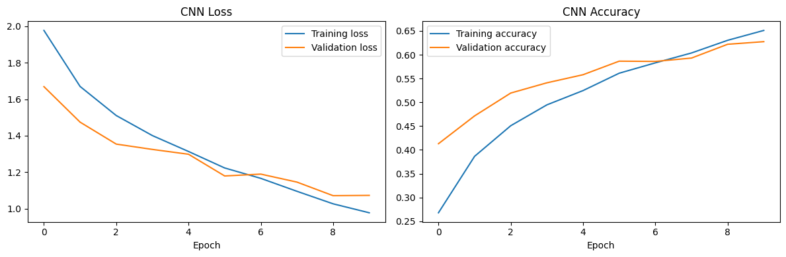
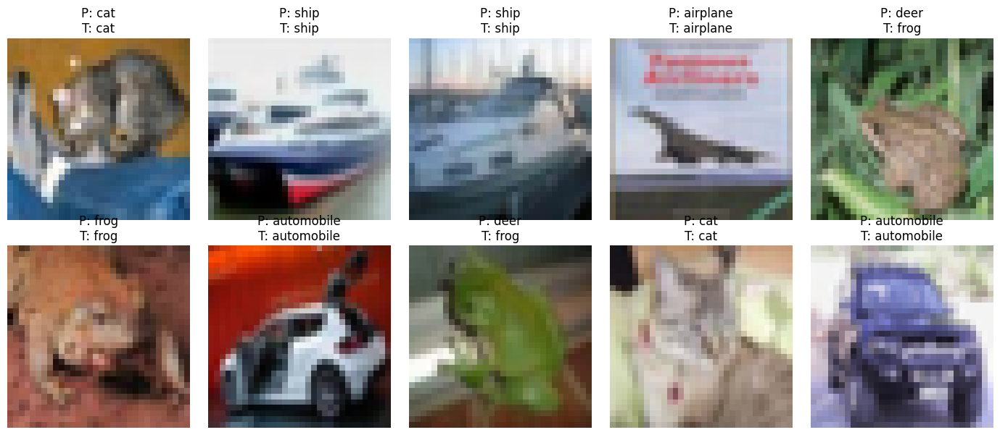

# Deep Learning Practical Test

A practical deep-learning notebook demonstrating neural networks, computer vision, time-series forecasting, and Transformer-based text classification.

## Project Overview

This project contains six practical sections:

1. **Artificial Neural Network (ANN)** — binary diabetes classification using the Pima Indians Diabetes dataset.
2. **OpenCV Image Processing** — resize images, convert to grayscale, apply Gaussian blur, detect edges with Canny, and draw a bounding rectangle.
3. **Convolutional Neural Network (CNN)** — classify images from the CIFAR-10 dataset.
4. **RNN/LSTM Forecasting** — forecast monthly airline passenger numbers and compare actual vs. predicted values.
5. **Transformer Text Classification** — use a pretrained Hugging Face sentiment-analysis pipeline.
6. **Model Comparison and Reflection** — collect available metrics and discuss model limitations.


### ▶️ Video Demonstration

> **Project Explanation Video:**  
> [Click here to watch the complete project explanation](https://drive.google.com/file/d/12UzQNgdFpnhN_HMX4oz1OFncnoTy1KxZ/view?usp=sharing)

> **Notebook:** `Practical-exam.ipynb`  
> Run the notebook cells from top to bottom. Scores depend on the dataset, training settings, and runtime; use the metrics produced by your own run.

## Project Structure

```text
Deep-Learning-Practical-Test/
├── Practical-exam(2).ipynb
├── diabetes.csv                 # Add this dataset locally; not included
├── AirPassengers.csv            # Optional local airline dataset
├── images/
│   ├── images (3).jpg
│   ├── images (4).jpg
│   └── images (5).jpg
├── opencv_outputs/
│   ├── processed_41586_2015_Article_BF52....jpg
│   ├── processed_images (2).jpg
│   ├── processed_images (3).jpg
│   ├── processed_images (4).jpg
│   └── processed_images (5).jpg
├── plots/
│   ├── Actual vs Predicted Passengers.png
│   ├── Airline Passenger Forecast.png
│   ├── ann_training_history.png
│   ├── CNN.png
│   ├── image_opencv.png
│   ├── Image-Classification.png
│   ├── Monthly Airline Passengers.png
│   └── plot_001.png
├── airline_12_month_forecast.csv
├── requirements.txt
└── README.md
```

*The image and plot filenames above follow the files shown in the project screenshot. Keep the actual filenames and capitalization unchanged, or update the paths in this README to match your repository.*

## Visual Results

### 1. OpenCV Image Processing

The OpenCV pipeline performs resizing, grayscale conversion, Gaussian blur, Canny edge detection, and a green bounding rectangle.



Processed images can also be viewed in the `opencv_outputs/` folder:

.jpg)

### 2. ANN Training History

The ANN learns to classify diabetes outcomes. Training and validation curves help identify possible overfitting.



### 3. CNN Image Classification

The CNN uses convolution and pooling layers to learn visual patterns from CIFAR-10 images.





### 4. Airline Passenger Forecasting

The LSTM section models sequential passenger counts. The charts compare the observed series with model predictions and future forecasts.


The generated forecast table is saved as `airline_12_month_forecast.csv` when the relevant notebook cell completes successfully.

## Datasets

### Diabetes dataset

Place `diabetes.csv` beside the notebook. The notebook expects a target column named `Outcome` and typically uses these features:

- `Pregnancies`
- `Glucose`
- `BloodPressure`
- `SkinThickness`
- `Insulin`
- `BMI`
- `DiabetesPedigreeFunction`
- `Age`

The dataset is not bundled with this README. Use a legitimate copy and check its license and provenance.

### CIFAR-10

The notebook loads CIFAR-10 through TensorFlow/Keras. The first download requires internet access. A configurable subset is used to make training more manageable.

### Airline passengers

The notebook can use a local `AirPassengers.csv` with `Month` and `Passengers` columns, or attempt to download a public copy when internet access is available.

## Installation

Use Python 3.10–3.12 if you encounter compatibility problems with deep-learning libraries. Create and activate a virtual environment, then install the dependencies.

```bash
python -m venv .venv
```

Windows:

```bash
.venv\Scripts\activate
```

macOS/Linux:

```bash
source .venv/bin/activate
```

Install dependencies:

```bash
python -m pip install --upgrade pip
pip install -r requirements.txt
```

If you do not have a `requirements.txt` yet, a starting set of packages for this notebook is:

```bash
pip install numpy pandas matplotlib scikit-learn opencv-python tensorflow transformers torch jupyter
```

Package compatibility can vary by Python version and operating system. If installation fails, install a TensorFlow release compatible with your Python version and restart the notebook kernel.

## How to Run

1. Clone or download this project.
2. Add `diabetes.csv` to the project root.
3. Add your input images to the `images/` folder.
4. Install the dependencies.
5. Open `Practical-exam(2).ipynb` in Jupyter Notebook, JupyterLab, or VS Code.
6. Run all cells in order.
7. Review the printed evaluation metrics and generated plots.
8. Confirm that image outputs and forecast CSV files are saved to the folders expected by your notebook.

## Evaluation

Depending on which sections have completed successfully, the notebook reports or visualizes:

- **ANN:** Accuracy, precision, recall, F1 score, confusion matrix, and training history.
- **OpenCV:** processed image outputs and edge/bounding-box visualization.
- **CNN:** training/validation curves and classification performance.
- **LSTM:** RMSE, actual-vs-predicted chart, and a 12-month forecast.
- **Transformer:** sentiment labels and scores for sample sentences.

Do not add unverified performance numbers to the README. Copy the actual values from your own notebook run if you want to include them.

## Important Notes

- The OpenCV bounding rectangle is a contour-based demonstration; it is not a trained object detector.
- Diabetes predictions are educational and must not be used as medical advice or for clinical decisions.
- Forecasts are demonstrations and are not guaranteed to predict real passenger demand accurately.
- Transformer sentiment scores are not guarantees of correctness and may be affected by sarcasm, context, language, or training-data bias.
- Large datasets and trained model files should generally not be committed to GitHub. Consider a dataset link or Git LFS when appropriate.

## Author

**Student Project — Deep Learning Practical Test**
